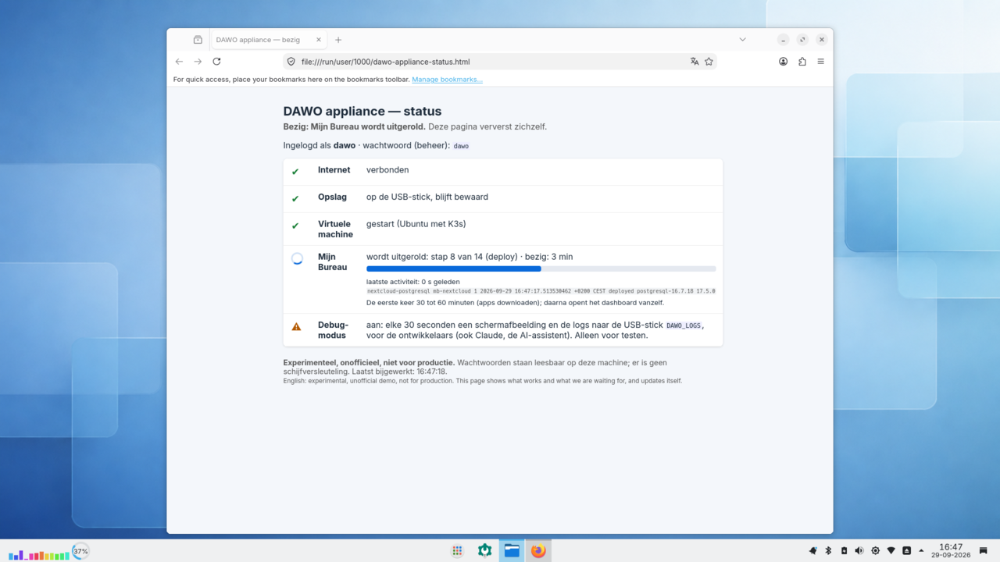
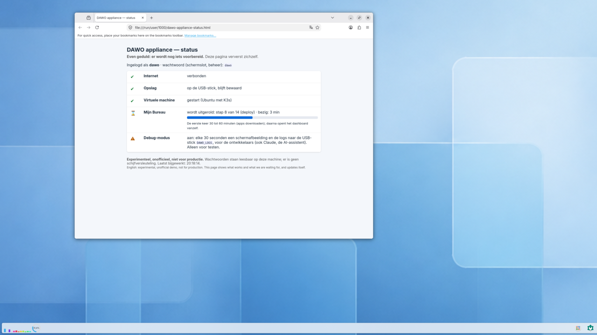

# DAWO-werkplek op een USB-schijf: voor gemeenten

> Experimenteel en onofficieel. Terug naar de [voorpagina](../../README.md).

Gemeenten worstelen met *vendor lock-in* (zoals Microsoft 365) en strenge BIO-eisen rond data in de cloud. Dit open-source project maakt digitale soevereiniteit tastbaar: **steek een USB-schijf in een gewone laptop, zet hem aan, en je werkt op een complete overheidswerkplek.** Er verandert niets op de laptop zelf.

Op de USB-schijf staat alles:
1. **De werkplek (DAWO):** het veilige Linux-bureaublad uit de BZK-pilots, met dezelfde programma's.
2. **De samenwerkingssuite (Mijn Bureau):** een lokaal draaiend alternatief voor OneDrive, Teams en Office (Nextcloud, Collabora, Element), met één inlog.

**Het grote voordeel:** alle documenten en data blijven op de USB-schijf. Er gaat geen byte naar commerciële cloud-providers.

#### In beeld (echte schermafbeeldingen van een testlaptop)

| Mijn Bureau installeert zichzelf | De voortgang, stap voor stap |
| --- | --- |
|  |  |
| Na het opstarten opent een statuspagina die laat zien wat werkt en waar het systeem op wacht. | Alle 14 stappen lukten op de testlaptop, in ongeveer 8 minuten. Daarna opent de knop Mijn Bureau. |

| Inloggen, één keer | Het dashboard Mijn Bureaublad |
| --- | --- |
|  |  |
| Inloggen met `launcher` / `launcher`. Deze ene inlog geldt voor alle apps. | Het startpunt: van hieruit open je bestanden en chat. |
| **Bestanden (Nextcloud)** | **Chat (Element)** |
|  |  |
| Het alternatief voor OneDrive. | Het alternatief voor Teams-chat, op de open standaard Matrix. |
| **Documenten bewerken (Collabora)** | |
|  | |
| Een Word-document maken en bewerken in de browser, vanuit Nextcloud. De menu's zijn nog Engels ([#180](https://github.com/EduardWitteveen/dawo-appliance/issues/180)). | |

Gemaakt door de debug-modus van de USB-schijf op een Dell Latitude 5550, alleen bijgesneden (herkomst: [`docs/screenshots/HARDWARE.md`](../screenshots/HARDWARE.md)).

#### Stand van zaken (15 oktober 2026)

| | |
| --- | --- |
| ✅ **Werkt** | Opstarten van USB zonder de laptop te veranderen · werkplek na 20 seconden · virtuele machine en Kubernetes binnen een minuut · gegevens blijven bewaard · netjes afsluiten · statuspagina met voortgang |
| ✅ **Werkt** | Mijn Bureau installeert zichzelf helemaal: alle 14 stappen gelukt (ongeveer 9 minuten als de apps al gedownload zijn) |
| ✅ **Werkt** | Eén keer inloggen (`dawo`/`dawo`) voor het dashboard, bestanden (Nextcloud), documenten bewerken (Collabora) en chat (Element), alles in het Nederlands; Nextcloud met het NL Design System-thema (Thematiq) |
| ✅ **Nieuw** | Te downloaden als schijfbestand voor Rufus of balenaEtcher (`dawo-appliance-live.img`); de eerste start maakt de rest van de USB-SSD zelf klaar als opslag |
| ✅ **Nieuw** | **De Launcher**: na het inloggen één venster met een kaart per omgeving. Mijn Bureau start na een minuut vanzelf (of met **Starten**), met een balk voor de hele start en een voor de huidige stap, de verwachte eindtijd en wat hij nu doet; daarna **Openen** |
| ⏭️ **Daarna** | Eerste testversie (v0.1.0-rc.1) om te downloaden; daarna meer omgevingen in de Launcher, zoals Valtimo met Open Zaak |

De technische details per stap staan hieronder in het Engelse deel en in de [issues op GitHub](https://github.com/EduardWitteveen/dawo-appliance/issues).

#### Wat heb je nodig?

- Een laptop met **32 GB geheugen** en virtualisatie aan in de BIOS (met 8 GB start alleen de werkplek).
- Een **USB-SSD van 64 GB of meer**. Een gewone USB-stick slijt snel van het schrijfwerk van de virtuele machine.
- **Internet**, de eerste keer, om Mijn Bureau te downloaden (ongeveer 10 minuten).
- Meer: [hardware-vereisten](../demo-hardware.md) en [de USB-schijf maken](../live-usb.md).

Wat elke app van Mijn Bureau doet, zie je in de [rondleiding langs de apps](mijn-bureau-apps.md). Hoe de onderdelen samenhangen en waar je gegevens staan, lees je in de [functionele architectuur](functionele-architectuur.md).

**Veelgestelde vragen:**
- *Is dit officieel?* Nee, dit is een onafhankelijk experiment (v0.1) op basis van de officiële broncode van de Rijksoverheid.
- *Kan dit morgen in productie?* Nee, het is bedoeld voor evaluatie en bestuurlijke demo's. Wachtwoorden staan leesbaar op de schijf en er is geen versleuteling.
